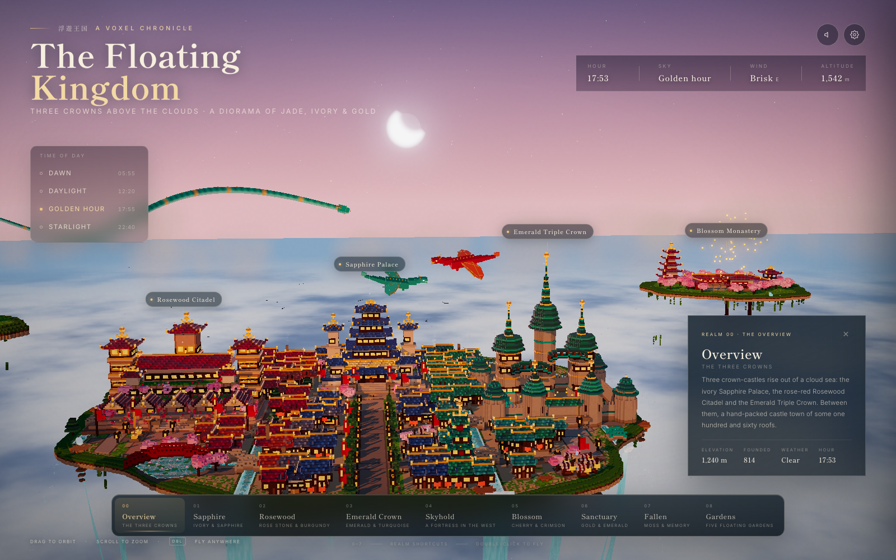

# The Floating Kingdom



*Golden hour over the three crowns — the live interface, not a mockup.*

A hand-built voxel fantasy diorama: three crown-castles floating above a sea of clouds, a Japanese castle town, satellite kingdoms, dragons, waterfalls, weather and a full first-person-free camera — all in **one self-contained HTML file**.

- **File:** `index.html` (~254 KB)
- **Hero screenshot:** `screenshot.png`
- **Runtime:** Three.js r160 via an import map from `cdn.jsdelivr.net`
- **Extra dependencies (JS):** none — Three.js post-processing addons come from the same Three.js package
- **Fonts:** Shippori Mincho + Inter from Google Fonts, with local serif/sans fallbacks
- **Build step:** none. The HTML is final.

---

## Running it

Open `index.html` directly in a browser, or serve the folder:

```bash
cd floating-kingdom
python3 -m http.server 8123
# open http://localhost:8123/index.html
```

Both `file://` and `http://` were tested. The first load needs an internet connection for the Three.js CDN and fonts; the scene itself is generated locally in JavaScript.

### Controls

| Action | Input |
| --- | --- |
| Orbit the camera | Drag |
| Zoom | Mouse wheel |
| Fly to a point | Double-click any voxel |
| Jump between realms | Keys `0`–`7` (`8` also opens Sky Gardens) |
| Navigate realms | Bottom realm bar |
| Open settings | Gear icon, top right |
| Toggle ambience | Speaker icon / settings switch |

Time presets, hour slider, day–night cycle, slow orbit, labels, planar reflections, audio and four weather states are in the settings drawer.

---

## What was built

### World

- **Three castles**, all visible in the opening wide triangle:
  - centre — *Sapphire Palace*: ivory five-tier keep, sapphire glazed roofs, gold finials, roofed plinth, hanging gardens, gatehouse, audience hall, pillar towers, crimson banners;
  - left — *Rosewood Citadel*: wide rose-sandstone plinth, five-gable crimson arcade, three stepped palace levels with terrace gardens, three square pillar towers with gold-ribbed burgundy roofs, gilded lions;
  - right — *Emerald Triple Crown*: curtain walls, round corner towers, octagonal gate towers, three tall layered octagonal spires with gold rings, two covered sky-bridges.
- **A castle town of 160 buildings** generated into available ground between the castles and avenues: shops with striped awnings and goods, 2–3-storey houses, lantern-balconied inns, temples, a five-tier pagoda, a bell tower, libraries, bathhouses with steam, workshops with chimney smoke, namako storehouses, shrine gates and zen gardens.
- Two market squares with stalls and fountains, tree-lined processional avenues with lamps, three canals, side and rear rivers, a lotus pond with a red arched bridge, lily pads and lotus blooms.
- **Five floating sky gardens** — wisteria pergola, bamboo tea house, standing stone circle, torii tunnel and moon-viewing pavilion — joined by arched bridges and glowing stepping-stone paths.
- **Satellite kingdoms:** Western Skyhold with a jade dragon on a crag, Blossom Monastery with cloister, pagoda, bell, koi pond and cherry trees, Eastern Sanctuary with terraced gardens, gold-columned emerald-roofed palace, twin pavilions, sacred crystals and a rotating heartstone, and the overgrown Fallen Kingdom.
- Stratified rocky island undersides, blocky stalactites, hanging vines, glowing crystal seams, crags and twelve waterfalls (ten main-island falls plus two in the Fallen realm) with foam, spray and cloud-sea mist.

### Rendering

- **Chunked voxel store:** 32³ chunks using `Uint8Array` palette indices.
- **Mesher:** hidden-face culling, per-vertex ambient occlusion, per-voxel deterministic colour jitter, indexed geometry merged per **64³ region × material**.
- **Materials by voxel kind:**
  - matte stone/wood;
  - `MeshPhysicalMaterial` glazed roofs with clearcoat;
  - metallic gold with strong environment reflection;
  - emissive windows, lanterns and crystals with a night-dependent, position-flickered shader;
  - foliage with a shared wind vertex sway.
- ACES filmic tone mapping; soft PCF shadows with `shadowMap.autoUpdate = false` and updates only when the directional light moves; sky-derived PMREM environment map; Unreal bloom; a custom grade/vignette pass; CSS grain and vignette layers.
- Planar water reflection rendered through a mirrored camera into a render target; the water shader mixes reflection, turquoise depth colour, sun glitter, ripple distortion and edge foam.
- Custom sky shader: gradient zenith/horizon, low sun disk above the palace, sun glow, separate additive starfield + Milky Way band, crescent moon, and a rainbow during sun showers.
- Animated cloud-sea shader and far billboard cumulus kept behind/below the skyline; almost no fog.
- Mobile-specific caps: reduced shadow map, reflection resolution, pixel ratio and composer scale on narrow screens.

### Living world

- Two flying winged dragons with flapping and banking, a long serpentine dragon (updated tube mesh with gold dorsal fins), and a breathing/stretching perched jade dragon.
- Birds, falling petals, rising sky lanterns at dusk/night, swaying foliage and flags, swinging bells, smoke/steam puffs, waterfall spray, rotating heartstone, lotus bobbing, window glow.
- Weather: clear, petal wind, sun shower (rain + rainbow) and first snow with progressive snow accumulation on upward-facing surfaces. Snow is a sorted/discarded overlay shader that grows across roofs, ground and ledges.
- Ambient WebAudio on user gesture: filtered wind with gusts, pentatonic chimes, and birdsong during daylight.

### Interface

- Glass masthead with title, subtitle, and almanac (hour, sky, wind, altitude).
- Dawn / Daylight / Golden hour / Starlight presets, hour slider, day–night cycle and slow orbit.
- Settings for mirror reflections, landmark labels, weather and audio.
- Bottom realm navigation with camera flights, realm info cards, and per-realm meta.
- Projected 3D landmark labels with collision suppression (especially useful on phone widths).
- Double-click fly-to, keyboard realm shortcuts, responsive phone layout, staged loading screen and cinematic opening descent.

---

## How it was made

The project was authored as a development shell (`shell.html`) plus a module source (`src.js`), then flattened into the final `index.html` with the entire module inlined. The final project is `index.html`, `screenshot.png`, `LICENSE` and this README.

1. **Layout and UI shell first.** The HTML/CSS defined the masthead, glass navigation, settings drawer, loading screen, labels, responsive breakpoints and the import map before any world geometry existed.
2. **Voxel engine.** A chunked palette world, a face mesher with AO and jitter, and a small architecture vocabulary — `box`, `frame`, `hipRoof`, `gableRoof`, `stairsDown`, `cyl`, pagoda tiers, torii, trees, lanterns, bridge spans — made the castles and town buildable at scale.
3. **Composition passes.** The three castles were positioned first; the town generator then packed buildings into free ground with road/reserve/footprint checks (ending at exactly 160 placed buildings). Satellites and the five gardens were added on their own island configs.
4. **Environment and simulations.** Sky/cloud/water/waterfall shaders, planar reflections, starfield and moon, weather particles, snow overlay, flags, bells, dragons and particles were layered on.
5. **Iteration with screenshots.** The page was run through a local HTTP server and captured with headless Microsoft Edge over the Chrome DevTools Protocol at desktop (1440×900) and phone (390×844) sizes. A small CDP harness took screenshots after injecting test states, which drove fixes to framing, the sky palette, the palette-name collision that turned Rosewood pink, water winding/culling, snow winding, the starfield, mobile layout and the opening composition.
6. **Verification.** The final file was loaded from both `http://localhost` and `file://`; console errors were empty; the realm nav (9 entries), settings, weather, keyboard, double-click and audio toggles were exercised. The final harness files were removed.

### Notes / intentional choices

- The **sky sun** is a painted, low-elevation disk above the palace so it stays in frame, while a separate front-left key light sculpts the facades. This is a deliberate cinematic lighting cheat.
- The **loading bar is presentational after the synchronous world build**; its stages advance while the shaders compile and the opening scene settles.
- The **reflection pass** is real-time at a reduced resolution on small screens; if disabled in settings, the water falls back to its painted turquoise and sun-glitter colour.
- All geometry is generated at load; there are no external models, textures or audio files.
- The opening wide shot intentionally crops part of the foreground town beneath the navigation bar; the full front edge and falling water are visible when the camera is lowered or moved.

---

## The prompt

```text
The Floating Kingdom

Build "The Floating Kingdom": a fully interactive Three.js voxel fantasy world as a single HTML file (three.js r160 via an importmap from cdn.jsdelivr.net, ES modules, no other dependencies).
TECHNICAL APPROACH
- Real voxel geometry: a chunked voxel store (32³ chunks, Uint8 palette indices), meshed with hidden-face culling and per-vertex ambient occlusion, merged into 64³ regions per material to keep draw calls low. Per-voxel colour jitter for a handcrafted look.
- Materials by voxel kind: matte stone, glossy glazed roof tiles, mirror gold (metal), glowing windows/lanterns (emissive that rises at night), emissive crystals, swaying foliage (vertex shader).
- ACES tone mapping, soft PCF shadows (re-render only when the light moves), environment map generated from the sky for reflections, bloom, light colour grade and vignette.
COMPOSITION (critical)
Three separate, equally grand castles visible at once in a wide triangle — the centre one set back, the side ones forward — so none hides another. The opening shot frames all three; on portrait phones the camera pulls back to keep them in frame.
1. Centre — Sapphire Palace: ivory walls on a 3-step stone plinth with hanging-garden ledges, roofed parapet, grand stair and gatehouse, a 5-tier Japanese keep with sapphire glazed roofs and gold ornaments, two tall flanking pillar towers, two front towers, a gold-gabled audience hall with a gold balcony, crimson banners, courtyard cherry trees and pines.
2. Left — Rosewood Citadel (wider, more horizontal): rose sandstone, a front arcade with five broad crimson gables, three stepped palace levels with terrace gardens, three massive square pillar towers, burgundy roofs with golden hip ribs, climbing roses, monumental stairs with gilded lions.
3. Right — Emerald Triple Crown (taller, narrower): curtain walls with round corner towers and octagonal gate towers, three tall octagonal towers with long pointed spires layered in flared emerald eaves and gold rings, two covered sky-bridges, turquoise accents.
TOWN
Procedurally pack ~160 Japanese castle-town buildings around and between the castles: shops with striped awnings and goods, 2–3 storey houses, inns with lantern balconies, temples, pagodas, bell towers with swinging bells, libraries, bathhouses with steam, workshops with chimney smoke, storehouses with namako walls, shrines with torii, zen gardens. Roof colours follow district (burgundy/terracotta left, sapphire/slate centre, emerald/teal right). Cobbled lanes, avenues lined with cypresses and lamp posts, two market squares with stalls and fountains.
SATELLITE KINGDOMS (each on its own floating island)
- Western Skyhold: walled fortress, blue-roofed keep and round towers; a jade dragon perched on a rock crag outside the walls.
- Blossom Monastery: crimson cloister halls, two-storey gate, 5-tier pagoda, bell tower, koi pond, ~40 cherry trees; sky lanterns rise from its courtyard.
- Eastern Sanctuary: terraced gardens, gold-columned palace with emerald roofs, twin octagonal pavilions, a ring of glowing sacred crystals around a floating, rotating heartstone.
- Fallen Kingdom: broken towers, collapsed arches, overgrown walls, rubble, waterfalls, broken bridge.
- Five small floating gardens (wisteria pergola, bamboo tea house, stone circle, torii tunnel, moon-viewing pavilion) joined by arched bridges and glowing stepping-stone paths with sparkles.
ENVIRONMENT
Islands with stratified warm-sandstone-to-slate rocky undersides, blocky stalactites, hanging vines and glowing crystals. A lotus pond with animated lily pads and a red arched bridge; three canals plus side and rear rivers. Ten turquoise waterfalls: curved animated sheets with foam lips, spray, sparkling droplets and mist where they meet a sea of clouds far below. Water uses a planar reflection plus sun glints and foam at the edges.
SKY & LIGHT
A custom sky shader: vivid blue zenith, a radiant sun disk placed in frame above the central palace, golden cloud undersides, stars, Milky Way and a crescent moon at night, a rainbow in sun showers. A shader cloud sea below, plus puffy cumulus kept behind or below the skyline so it never covers the castles. Almost no fog. Sunny, saturated, crisp.
ANIMATION
Two flying winged dragons with flapping wings and banking, a long serpentine dragon weaving around the island, the perched dragon breathing and stretching, waving flags/pennants in one shared wind, swinging bells, chimney smoke, falling petals, circling birds, rising sky lanterns (dusk/night), flowing water, flickering window glow.
UI (elegant, glass panels, Japanese mincho display font + clean sans)
- Masthead: "The Floating Kingdom", subtitle, almanac (hour, sky, wind, altitude).
- Time presets: Dawn / Daylight / Golden hour / Starlight; settings panel with day-night cycle, slow orbit, ambient WebAudio sound (wind, chimes, birdsong), landmark labels, mirror reflections, weather (clear, petal wind, sun shower, first snow — snow accumulates on roofs), hour slider.
- Bottom realm navigation with smooth camera flights and an info card per realm; 3D landmark labels; double-click anywhere to fly there; keys 0–7 jump between realms.
- Loading screen with staged progress; cinematic opening descent; responsive down to phone width.
STYLE
Premium handcrafted voxel diorama, Japanese castle roofs blended with grand medieval fantasy, rich materials, beautiful reflections, cinematic composition — more colourful and sunny than a typical voxel scene.
```

---

*The Floating Kingdom was generated procedurally with code and iterated visually. No external voxel models, textures or audio samples were used.*
